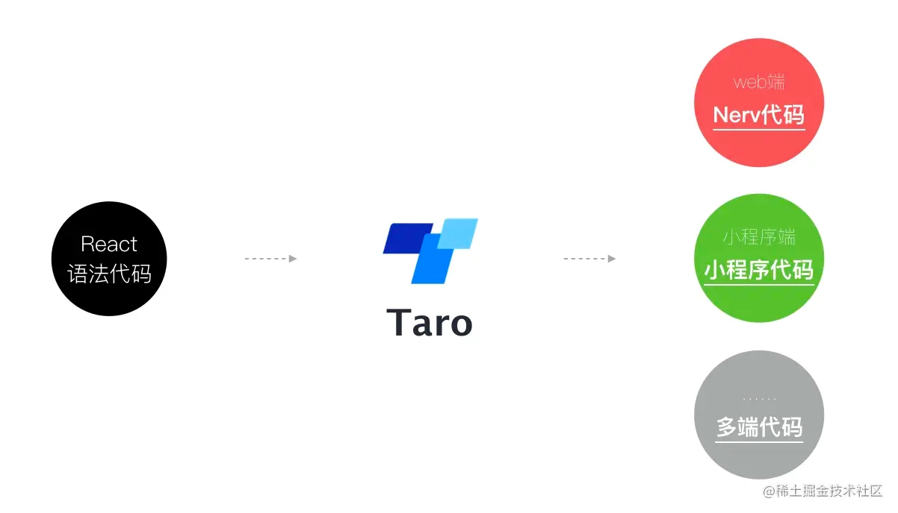
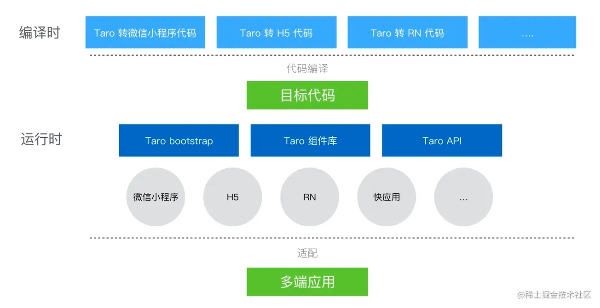

## 多端转换原理

同一套代码，通过某一框架将源码编译转换操作。

## 抹平多端差异

**每个平台存在的差异**

- 不同组件标准
- 不同API标准
- 不同的运行机制

为了抹平这些差异，除了**编译时**对平台作出不同处理，还需要一套**运行时**标准来抹平不同平台之间的差异

**Taro的标准有三部分组成**

- 标准运行时框架 （通用）
- 标准基础组件库   （**@tarojs/components**）
- 标准端能力API （**@taro/taro**）

### 基本架构

**编译时**： 根据编译的平台，按不同端的代码结构

**运行时：** 通过定义三个标准抹平个端差异

## 编译

### 入口

cli  —— 根据 type 引入不同的插件，处理 根据不同平台插件处理webpack传参、清空dist 文件、生成project.config.json

mini-runner （webpack），生成webpack配置，创建webpack 实例，最总生成目标模板。

**源码解析**

### 编译工作流与抽象语法树

将**一种结构化语言的代码**编译成另**外一种类似结构化语言**的代码步骤

1. Parse，将代码解析成抽象语法树（AST）
2. 对AST进行遍历与替换，生成新的AST
3. Generate ，根据新的AST生成编译后的代码

### babel模块

Taro对代码进行编译是依赖babel模块来实现的。我们可以大概了解以下模块

- Babylon Babel 的解析器。最初是从 Acorn 项目 fork 出来的。Acorn 非常快，易于使用，并且针对非标准特性(以及那些未来的标准特性) 设计了一个基于插件的架构。
- Babel-traverse 负责维护整棵树的状态，并且负责替换、移除和添加节点。
- Babel-types 一个用于 AST 节点的 Lodash 式工具库， 它包含了构造、验证以及变换 AST 节点的方法。 该工具库包含考虑周到的工具方法，对编写处理 AST 逻辑非常有用。
- Babel-generator Babel 的代码生成器，它读取 AST 并将其转换为代码和源码映射（sourcemaps）。
- Babel-template 让编写字符串形式且带有占位符的代码来代替手写编码，很适用于生成大规模AST的时候，在计算机科学中，这种能力成为准引用？

### 解析页面 Config 配置

主要三个步骤，将工程里的 config 配置转换成对应的JSON配置文件

1. babel-traverse方法， 遍历和更新节点
2. 遍历、解析为JSON对象
3. 写入对应目录的 *.json 文件